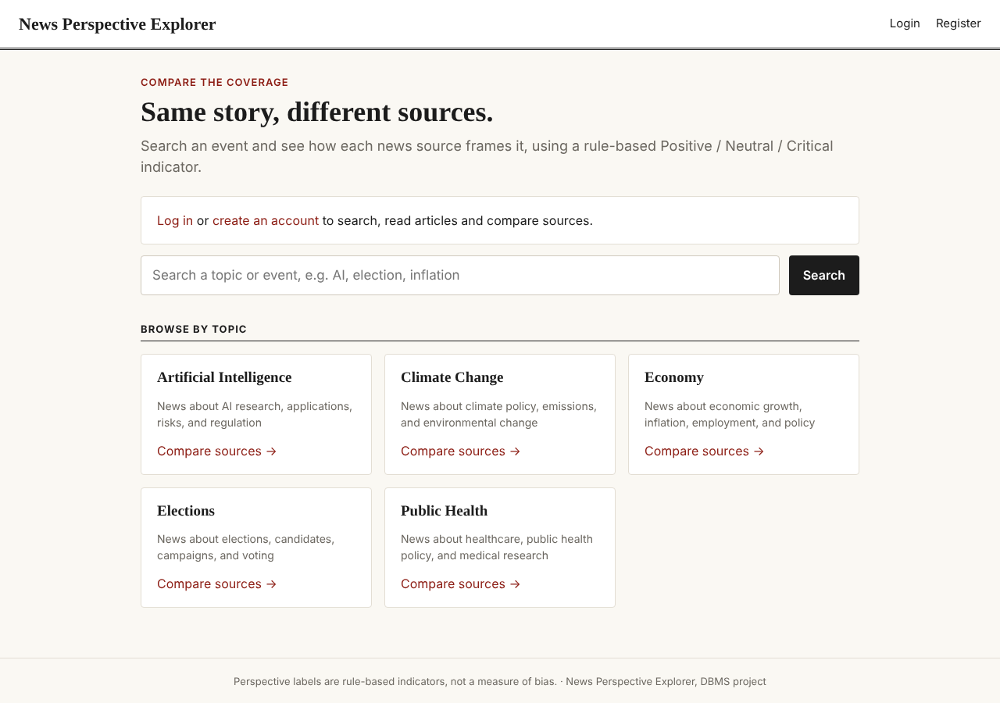
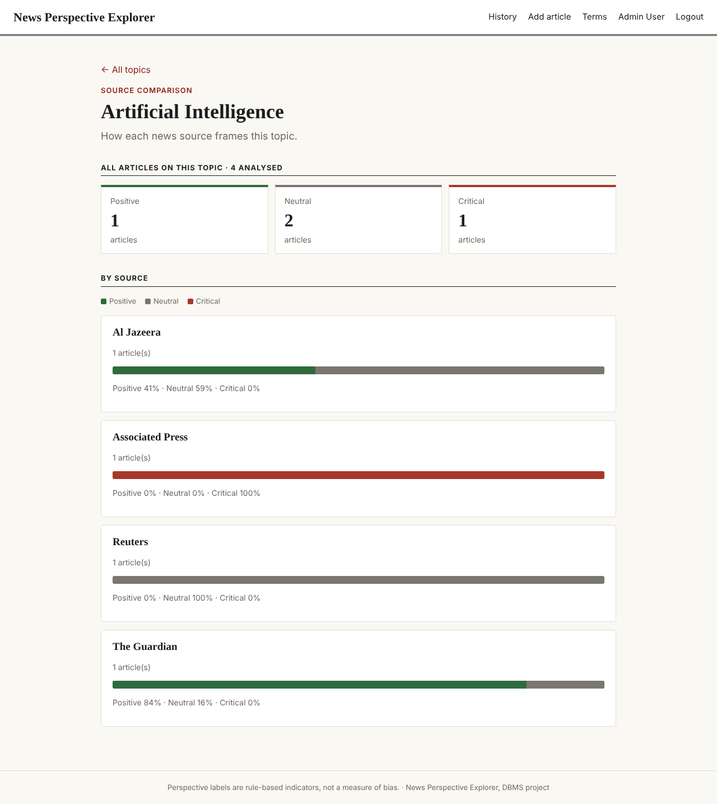
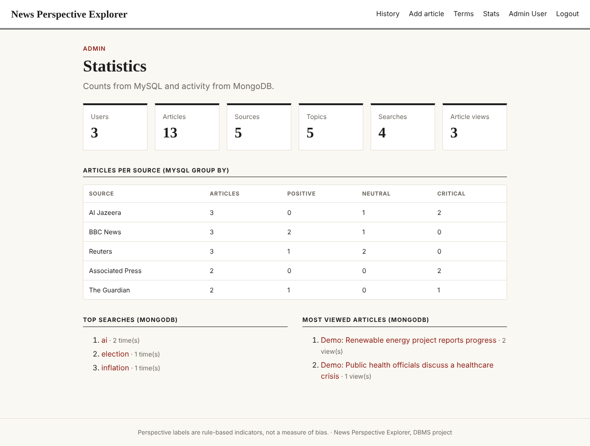

# News Perspective Explorer

A DBMS project that shows how different news sources frame the same event.
Search a topic, read articles from several sources, see a **rule-based
Positive / Neutral / Critical perspective indicator** for each one, and compare
sources side by side.

The label is a transparent word-counting indicator, not a measure of bias:
every article shows which words produced its label.

**Stack:** Next.js (frontend) · FastAPI / Python (backend) · MySQL + MongoDB (both named `news_perspective_db`)

| Home | Article with perspective panel |
|---|---|
|  |  |
| **Source comparison** | **Admin statistics** |
|  |  |

## Features

**Readers** (login required)
- FULLTEXT search, results grouped by source, with perspective and source filters
- Article page: perspective panel (label, scores, matched words), matched words highlighted in the text, keywords, related articles from other sources
- Source comparison per topic: label counts and each source's Positive / Neutral / Critical share
- Personal reading history

**Admins**
- Add articles (saved by a stored procedure in one transaction, scored automatically) and delete them
- Add, edit and delete perspective terms and weights; a trigger flags articles and they are re-scored
- Statistics page: MySQL totals and GROUP BY, MongoDB aggregations on searches and views

**Security:** bcrypt password hashes, JWT login tokens, admin/reader roles checked in the backend (401/403), parameterised SQL.

## Documentation

| Document | What's in it |
|---|---|
| [docs/PRESENTATION_GUIDE.md](docs/PRESENTATION_GUIDE.md) | How everything works: architecture, database design, CRUD list, triggers, procedures, views, MongoDB, Next.js, security, the scoring algorithm, modification recipes, viva questions |
| [docs/DEMO_COMMANDS.md](docs/DEMO_COMMANDS.md) | Every demo command in order: reset, start, website walkthrough, MySQL and MongoDB demos |
| [docs/ER_DIAGRAM.md](docs/ER_DIAGRAM.md) | ER diagrams for MySQL and the MongoDB links (`er-mysql.png`, `er-mongodb.png`) |

## Database at a glance

**MySQL (8 tables):** `users`, `sources`, `topics`, `articles`, `article_topics` (many-to-many bridge), `perspective_categories`, `perspective_terms`, `article_perspectives`

**MongoDB (6 collections):** `article_content`, `article_metadata`, `perspective_analysis`, `search_logs`, `reading_history`, `comparison_sessions`, linked to MySQL by the same integer `article_id` / `user_id` / `topic_id`

| Advanced SQL | Objects |
|---|---|
| Stored procedures | `sp_add_article` (transaction + rollback), `sp_change_user_role` (validation), `sp_topic_perspective_summary` (OUT parameters) |
| Triggers | `trg_articles_before_insert`, `trg_users_before_insert`, `trg_perspective_terms_after_update`, `trg_perspective_terms_after_delete` |
| Views | `v_article_details`, `v_source_perspective_summary` |
| Database roles | `npe_app_role` (data only, no DDL) used by the backend; `npe_readonly_role` (SELECT only); managed with CREATE ROLE, GRANT, REVOKE |
| Other | FULLTEXT index + `MATCH … AGAINST`, CHECK / UNIQUE / FK with CASCADE and RESTRICT, self-join, upsert, 12 viva queries in `queries.sql` |

## Project structure

```
backend/                 FastAPI app
  app.py                 creates the app, includes every router
  routes/                one file per feature (auth, search, articles, compare, history, admin_*)
  services/              shared logic: auth, scoring, keywords, comparison, history
  db/                    MySQL and MongoDB connections (settings from .env)
  seed_content.py        loads article text into MongoDB and scores every article
frontend/                Next.js (App Router)
  app/                   one folder per page; [param] folders are URL parameters
  components/            NavBar, SearchBar, ArticleCard, PerspectivePanel, HighlightedText
  lib/api.js             every backend call, adds the login token
database/
  mysql/                 01 schema · 02 ALTER/DROP demo · 03 views · 04 procedures · 05 triggers
                         06 seed data · 07 CRUD demo · queries.sql (viva queries)
  mongodb/               01 collections + validators · 02 indexes · 03 seed · 04 CRUD demo
                         aggregations.js · article_content.json
docs/                    guide, demo commands, ER diagrams, screenshots
```

## Setup

You need MySQL 8, MongoDB (with `mongosh`), Python 3.10+ and Node.js 18+.
Run every command from the project folder unless it says `cd`.

**1. MySQL**
```bash
mysql -u root -p
```
```sql
source database/mysql/01_schema.sql;
source database/mysql/03_views.sql;
source database/mysql/04_procedures.sql;
source database/mysql/05_triggers.sql;
source database/mysql/06_seed_data.sql;
source database/mysql/08_db_roles.sql;
exit;
```

**2. MongoDB**
```bash
mongosh database/mongodb/01_collections.js
mongosh database/mongodb/02_indexes.js
mongosh database/mongodb/03_seed.js
```

**3. Backend** (terminal 1)
```bash
cd backend
python -m venv venv
venv\Scripts\activate              # Mac/Linux: source venv/bin/activate
pip install -r requirements.txt
copy .env.example .env             # Mac/Linux: cp .env.example .env
# edit .env: set JWT_SECRET (MySQL user is npe_app from 08_db_roles.sql)
python seed_content.py
uvicorn app:app --reload --port 8000
```

**4. Frontend** (terminal 2)
```bash
cd frontend
npm install
copy .env.example .env.local       # Mac/Linux: cp .env.example .env.local
npm run dev
```

Open **http://localhost:3000**. API docs with a "Try it out" button are at
**http://localhost:8000/docs**.

To start over with fresh data, see section 0 of [docs/DEMO_COMMANDS.md](docs/DEMO_COMMANDS.md).

## Demo logins

| Email | Password | Role |
|---|---|---|
| admin@example.com | admin123 | admin |
| reader1@example.com | reader123 | reader |
| reader2@example.com | reader123 | reader |

New accounts registered on the website are always readers. Promote one with
`CALL sp_change_user_role('email@example.com', 'admin');`

## API

| Method | Endpoint | Access |
|---|---|---|
| POST | `/register`, `/login` | public |
| GET | `/topics`, `/sources` | public |
| GET | `/search?query=…` | logged in |
| GET | `/articles/{id}`, `/articles/{id}/related`, `/keywords/{id}` | logged in |
| GET | `/analyze/{id}` | logged in |
| GET | `/compare/{topic_id}`, `/perspectives/{topic_id}` | logged in |
| GET / POST | `/history/{user_id}`, `/history` | logged in, own history (admins: anyone's) |
| POST / DELETE | `/admin/articles`, `/admin/articles/{id}` | admin |
| GET / POST / PUT / DELETE | `/admin/terms`, `/admin/terms/{id}` | admin |
| GET | `/admin/stats` | admin |

## Team

| | Module | Owns |
|---|---|---|
| **Person 1:** Samhitha | Search, articles and users | `users`, `topics`, `articles`, `article_topics`; `article_content`, `article_metadata`, `search_logs` |
| **Person 2:** Samika | Perspective, comparison and history | `sources`, `perspective_categories`, `perspective_terms`, `article_perspectives`; `perspective_analysis`, `reading_history`, `comparison_sessions` |

Naming rules both modules follow: snake_case everywhere; `article_id`,
`topic_id` and `user_id` as the shared ids; ISO 8601 dates in API JSON;
never commit `.env`.
