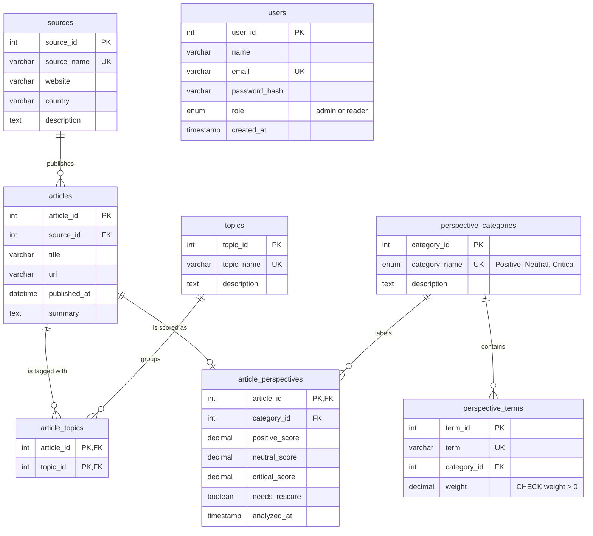
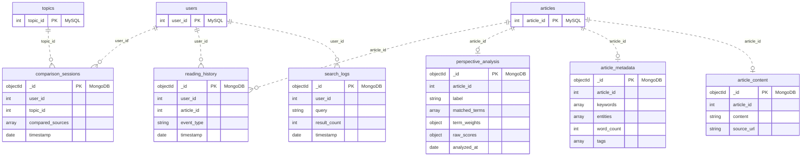

# ER diagrams

Image files for slides: `er-mysql.png` and `er-mongodb.png`.
The `.mmd` files are the Mermaid source. To regenerate the images:
`npx -p @mermaid-js/mermaid-cli mmdc -i docs/er-mysql.mmd -o docs/er-mysql.png -b white -s 2`

## 1. MySQL (relational schema)

How to read the line ends: `||` = exactly one, `o|` = zero or one, `o{` = zero or many.

| Relationship | Type | How it is built |
|---|---|---|
| sources → articles | one-to-many | `articles.source_id` FK, ON DELETE RESTRICT |
| articles ↔ topics | many-to-many | bridge table `article_topics` with a composite PK (article_id, topic_id), ON DELETE CASCADE |
| articles → article_perspectives | one-to-zero-or-one | `article_perspectives.article_id` is both PK and FK |
| perspective_categories → perspective_terms | one-to-many | `perspective_terms.category_id` FK |
| perspective_categories → article_perspectives | one-to-many | `article_perspectives.category_id` FK |
| users | no FK in MySQL | linked to MongoDB collections by `user_id` (diagram 2) |

## 2. How MongoDB links to MySQL

Dashed lines are **logical** links. MongoDB has no foreign keys, so the backend
keeps the ids matching: every document stores the same INT `article_id`,
`user_id` or `topic_id` as the MySQL row. Each document's own key is
MongoDB's `_id`.

Why these are in MongoDB: article text is long and unstructured; keywords
and matched terms are arrays; logs and history are append-only events that
grow fast and need no joins.

